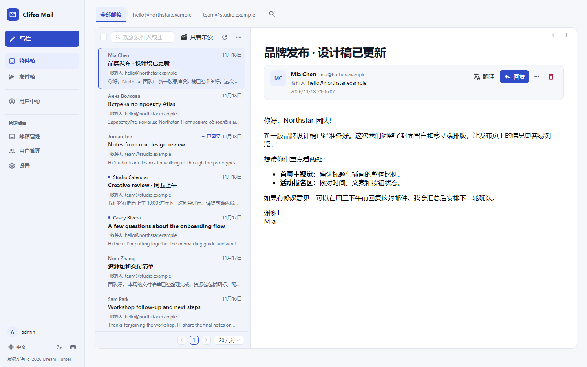
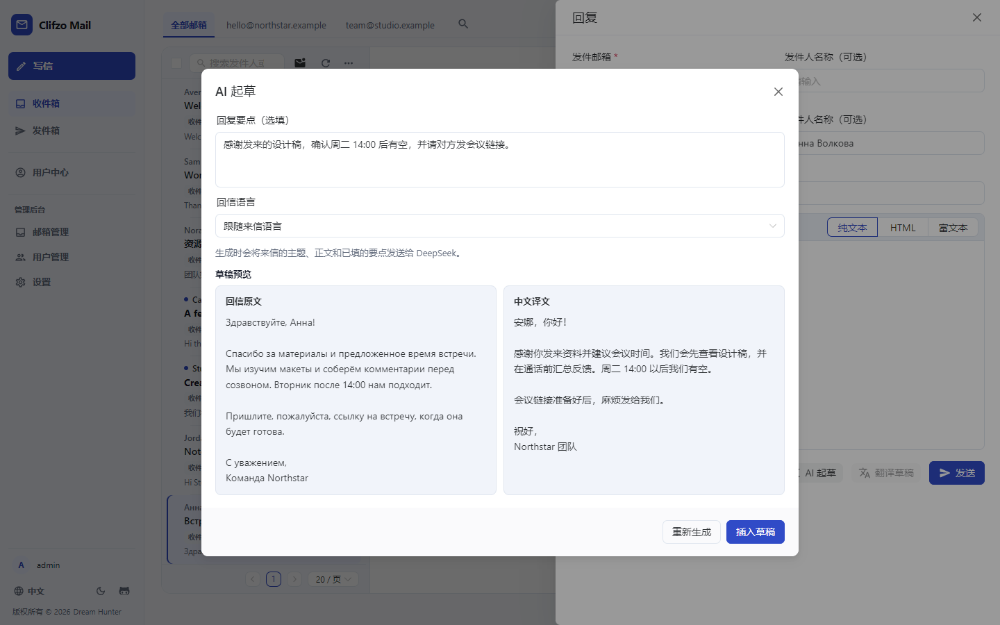
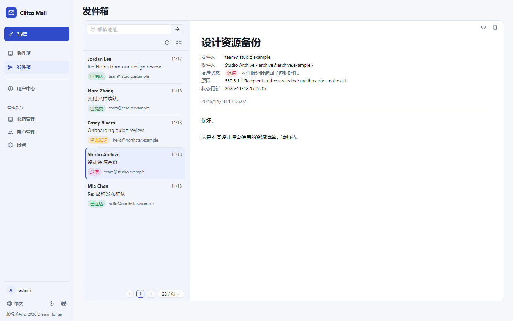
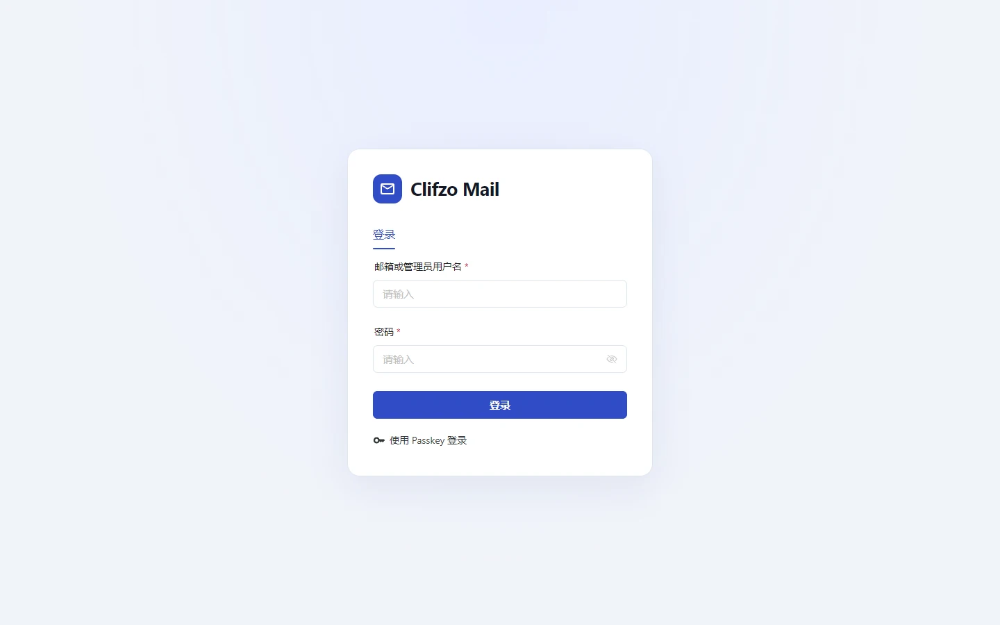
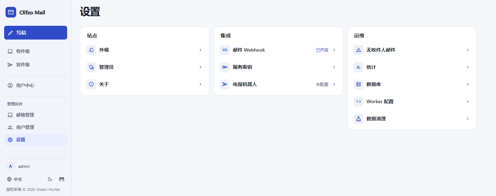

# Clifzo Mail

基于 Cloudflare 的多域名邮箱工作台。支持用自有域名收信、通过 Resend 发信，以及用 DeepSeek 翻译邮件和起草回复。

[打开 Clifzo Mail](https://mail.kitt.tools/login) · [部署指南](vitepress-docs/docs/zh/guide/cli/worker.md#clifzo-mail-自动部署) · [更新日志](CHANGELOG.md) · [English](README_EN.md) · [日本語](README_JA.md)

## 邮箱工作台

- **收件箱**支持切换邮箱、按发件人或主题搜索整个邮箱、筛选未读和批量操作。回复提交成功后，原邮件在列表中标记为「已回复」。
- **写信与回复**支持按域选择发件地址，并把常用地址保存到管理员账号。新邮件使用默认地址，回复沿用原收件地址并保留会话关联。
- **邮件翻译**支持来信和草稿意译，保留段落、加粗、列表和链接等格式。D1 按邮件和语言保存来信译文，下次打开可直接查看并一键切回原文。

### AI 起草回复

在回复窗口点击「AI 起草」。可以用中文写几个要点，也可以直接根据来信起草。默认按来信语言生成回信，可手动指定语言。原语草稿和中文译文同时预览，选用草稿后还可以编辑，再由你发送。

### 发件箱与投递状态

发件箱在收件箱下方。接入 Resend Webhook 后，可查看已提交、已送达、退信和失败等状态。退信或失败时显示 Resend 提供的原因。已送达表示收件服务器已接收邮件。[配置投递回调](vitepress-docs/docs/zh/guide/feature/send-mail-api.md#resend-投递状态)

### 登录与设置

管理员使用用户名 `admin` 和管理员密码登录，可管理邮箱、用户、发件地址和服务密钥。开启仅收信模式后，普通用户可以创建邮箱、接收邮件，并用自己的 DeepSeek Key 翻译来信。[登录方式](vitepress-docs/docs/zh/guide/login.md) · [服务密钥配置](vitepress-docs/docs/zh/guide/worker-vars.md#服务密钥和仅收信模式)

查看登录页和设置截图

截图使用本地演示邮箱和示例邮件。

## 部署

生产站点运行在 `mail.kitt.tools`。Cloudflare Email Routing 接收 `kitt.tools` 和 `clifzo.com` 的来信，Worker 将邮件写入 D1，并通过 Static Assets 提供 Vue 3 单页界面。Resend 负责配置过的域名发信。

推送此仓库的 `master` 会触发 Cloudflare Workers Builds。

| 构建设置 | 值 |
| --- | --- |
| 生产分支 | `master` |
| 根目录 | `worker` |
| 构建命令 | `pnpm run build:assets` |
| 部署命令 | `pnpm run deploy` |

自行部署时，在 [Wrangler 模板](worker/wrangler.toml.template) 中填入自己的 Worker、域名和资源绑定，按 [D1 指南](vitepress-docs/docs/zh/guide/cli/d1.md) 初始化数据库，并将每个收信域名的 [Email Routing](vitepress-docs/docs/zh/guide/email-routing.md) 指向自己的 Worker。需要发信时，先在 Resend 验证发件域名，再到 **设置 → 服务密钥** 按域配置 Key。[完整部署指南](vitepress-docs/docs/zh/guide/cli/worker.md)

## 上游与许可

Clifzo Mail 基于 Dream Hunter 的 [Cloudflare Temp Email](https://github.com/dreamhunter2333/cloudflare_temp_email)，沿用 [MIT 许可](LICENSE)。邮件解析使用 Rust WASM，前端使用 Vue 3、Vue Router、Vite 和 Naive UI。更多扩展配置见[项目文档](vitepress-docs/docs/zh/guide/worker-vars.md)。
