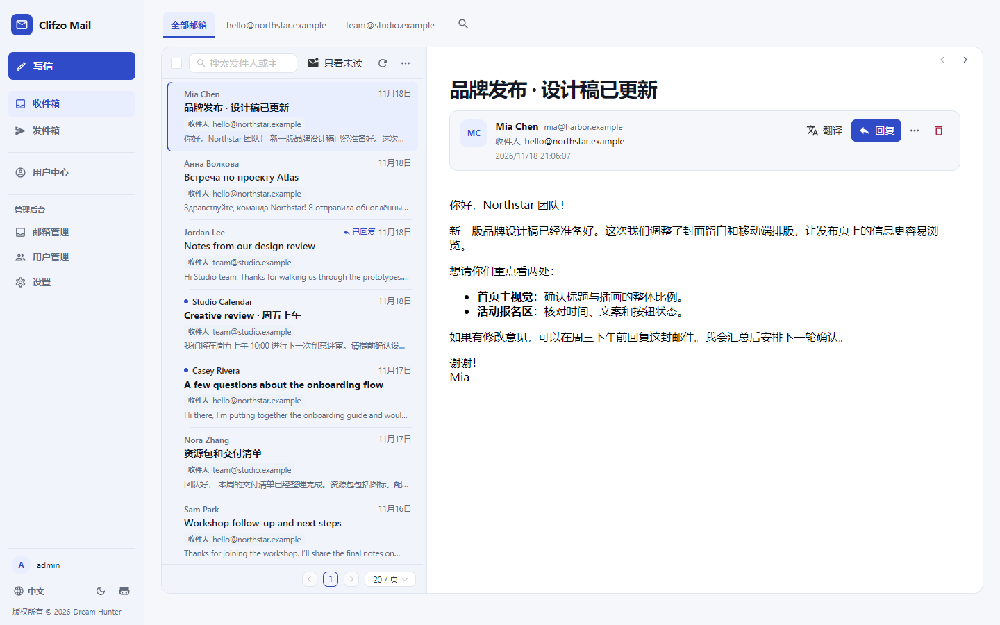
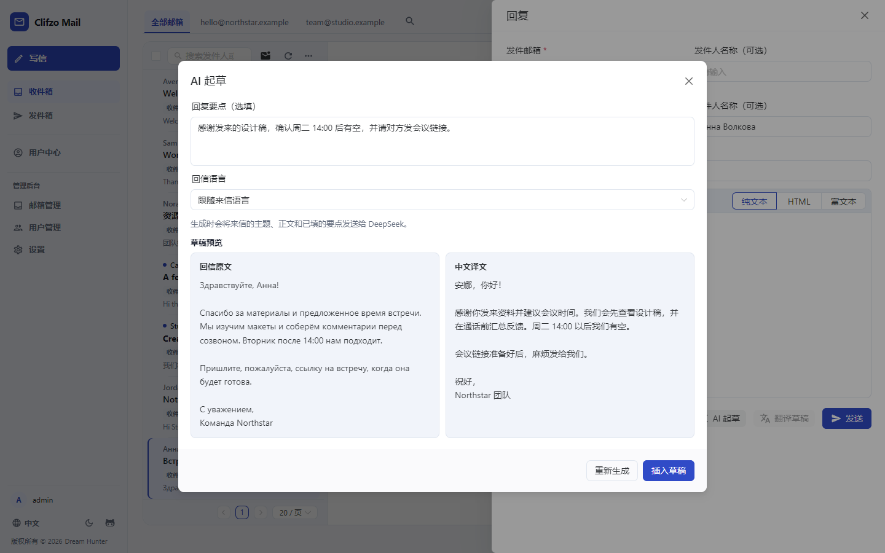
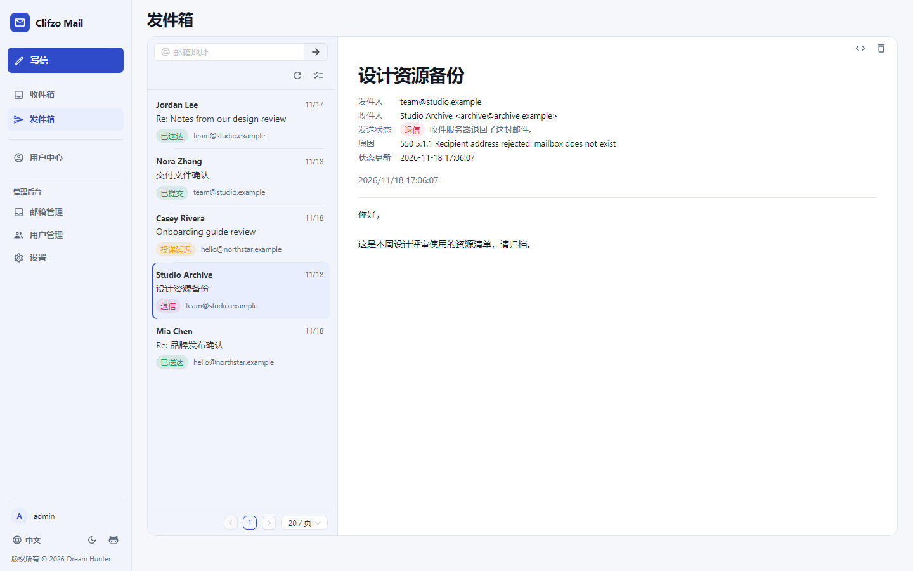
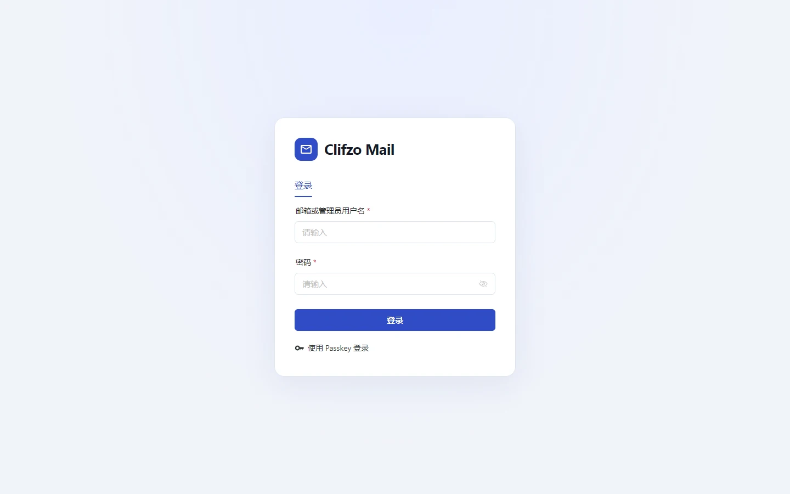
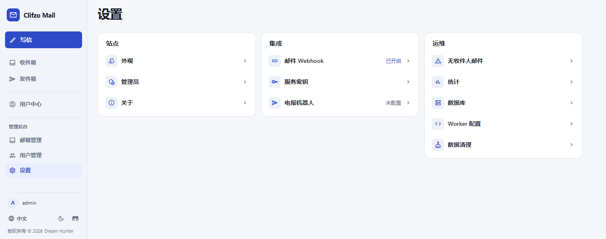

# Clifzo Mail

Clifzo Mail is a self-hosted, multi-domain email workspace. It receives mail through Cloudflare Email Routing, stores mail in D1, and sends through Resend. DeepSeek supports mail translation and reply drafting.

[Open Clifzo Mail](https://mail.kitt.tools/login) · [Deployment](#deployment) · [Changelog](CHANGELOG_EN.md)

[简体中文](README.md) · English · [日本語](README_JA.md)

The screenshots use sample mailboxes and messages.

## Mail workspace

- **Inbox** — switch between mailboxes, search by sender or subject across the selected mailbox, and filter for unread mail.
- **Translation** — translate incoming messages and drafts while keeping rich-text formatting. Open saved translations from any browser and switch back to the original at any time.
- **Compose** — save favorite sender addresses and select a default for new messages. Replies keep the original receiving address and thread.

### AI-assisted replies

Draft a reply from the incoming message, with optional notes and a language choice. Review the draft alongside a Simplified Chinese translation, then edit and send it from the composer.

### Sent mail

The sent folder shows updates from signed Resend webhooks, including delivery, delays, bounces, and failures. When Resend provides a reason, it appears in the message details.

### Accounts and settings

Administrators sign in as `admin` to manage users and mailboxes, configure a Resend key per sending domain, and set up DeepSeek for translation and reply drafting. With receive-only mode enabled, registered users can create mailboxes, receive mail, and translate messages with their own DeepSeek key. [Sign-in guide](vitepress-docs/docs/en/guide/login.md)

View sign-in and settings screenshots

## Deployment

[mail.kitt.tools](https://mail.kitt.tools) serves the Vue 3 and Vite single-page app and the Hono API from a single Cloudflare Worker. Cloudflare Email Routing forwards incoming mail for `kitt.tools` and `clifzo.com` to the Worker. D1 stores mailbox data, messages, and incoming translations.

Cloudflare Workers Builds deploys the production Worker automatically on pushes to `master`.

| Workers Builds setting | Value |
| --- | --- |
| Production branch | `master` |
| Root directory | `worker` |
| Build command | `pnpm run build:assets` |
| Deploy command | `pnpm run deploy` |

[Worker deployment and upstream sync](vitepress-docs/docs/en/guide/cli/worker.md#clifzo-mail-automatic-deployment)

## Self-hosting

Start with [the Worker configuration template](worker/wrangler.toml.template) and [the D1 schema](db/schema.sql) for a separate instance. Configure [Cloudflare Email Routing](vitepress-docs/docs/en/guide/email-routing.md) for your own receiving domains. To send with Resend, verify the sending domains, configure the matching [provider keys](vitepress-docs/docs/en/guide/worker-vars.md#provider-keys-and-receive-only-mode), and set up the [delivery webhook](vitepress-docs/docs/en/guide/feature/send-mail-api.md#resend-delivery-status).

[Deployment and configuration guides](vitepress-docs/docs/en/guide/cli/worker.md) · [Upstream documentation](https://temp-mail-docs.awsl.uk/en/)

## Credits and license

Clifzo Mail is based on [Dream Hunter’s Cloudflare Temp Email](https://github.com/dreamhunter2333/cloudflare_temp_email) and is distributed under the [MIT License](LICENSE).
