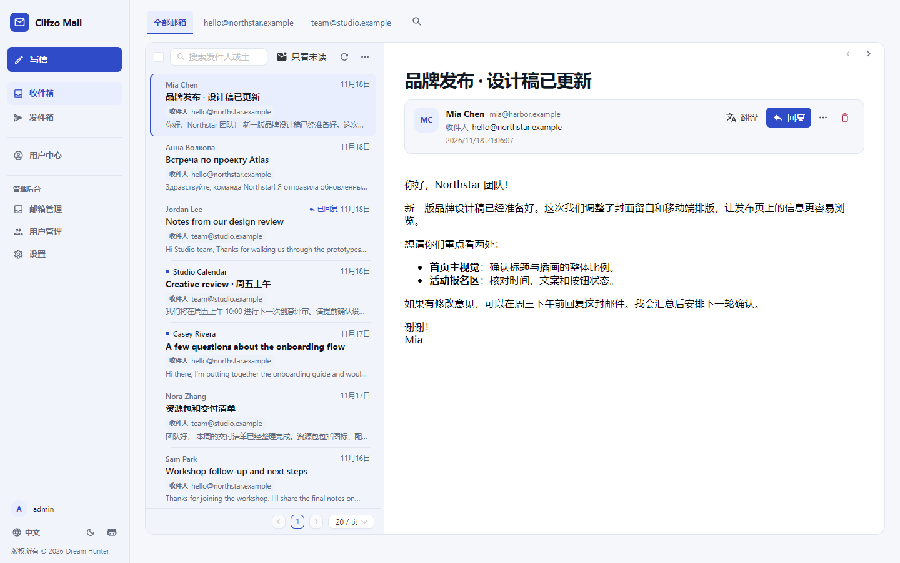

# Clifzo Mail

Clifzo Mail は、複数のドメインに対応したセルフホスト型メールサービスです。Cloudflare Email Routing で受信し、D1 に保存し、Resend で送信します。DeepSeek を使ったメール翻訳と返信の下書きにも対応しています。

[Clifzo Mail を開く](https://mail.kitt.tools/login) · [デプロイ](#デプロイ) · [変更履歴（英語）](CHANGELOG_EN.md)

[简体中文](README.md) · [English](README_EN.md) · 日本語

画面にはサンプルのメールとアドレスを使用しています。

## 主な機能

- **受信箱** — メールボックスを切り替え、選択したメールボックス内を差出人や件名で検索できます。未読メールだけを表示することもできます。
- **メール翻訳** — リッチテキストの書式を保ったまま翻訳できます。受信メールの翻訳は D1 に保存され、別のブラウザーからも表示できます。
- **AI による返信の下書き** — 受信メールから返信案を生成し、中国語訳と見比べながら確認できます。必要に応じて編集し、元の受信アドレスから同じスレッドに返信します。
- **送信済みメール** — Resend の Webhook により、配信済み、遅延、バウンス、送信失敗などの状態を確認できます。
- **アカウント管理** — 管理者はユーザー、メールボックス、送信用ドメインごとの Resend キーを管理できます。受信専用モードでは、一般ユーザーはメールボックスの作成と受信に加え、自分の DeepSeek キーで受信メールを翻訳できます。

## デプロイ

本番サイト [mail.kitt.tools](https://mail.kitt.tools) は、Vue 3 の画面と Hono の API をひとつの Cloudflare Worker から配信しています。`kitt.tools` と `clifzo.com` 宛てのメールは Cloudflare Email Routing で受信します。

| Workers Builds の設定 | 値 |
| --- | --- |
| 本番ブランチ | `master` |
| ルートディレクトリ | `worker` |
| ビルドコマンド | `pnpm run build:assets` |
| デプロイコマンド | `pnpm run deploy` |

`master` にプッシュすると、Cloudflare Workers Builds が本番環境へ自動でデプロイします。自分のインスタンスを構築する場合は、[デプロイガイド（英語）](vitepress-docs/docs/en/guide/cli/worker.md)を参照してください。

## オリジナルプロジェクトとライセンス

Clifzo Mail は [Dream Hunter の Cloudflare Temp Email](https://github.com/dreamhunter2333/cloudflare_temp_email) をベースにしています。[MIT ライセンス](LICENSE)で公開されています。関連コンポーネントについては[オリジナルプロジェクトの日本語 README](https://github.com/dreamhunter2333/cloudflare_temp_email/blob/main/README_JA.md)も参照できます。
